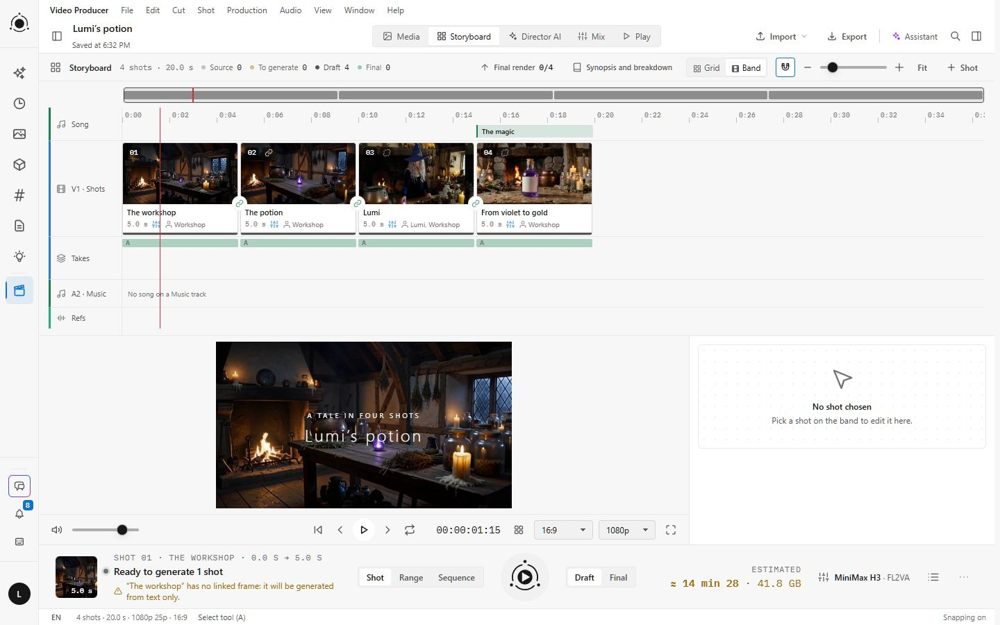
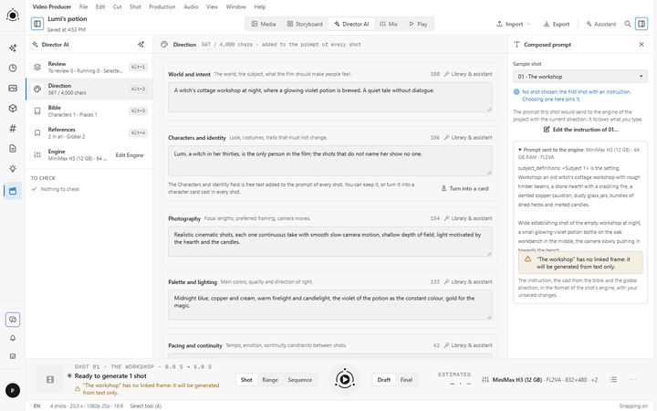
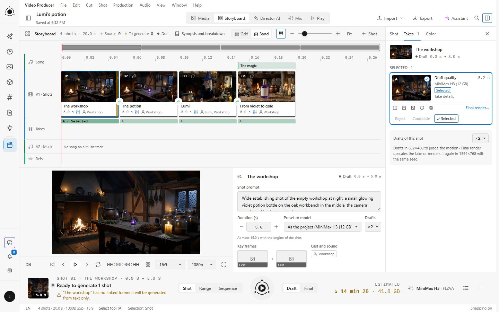
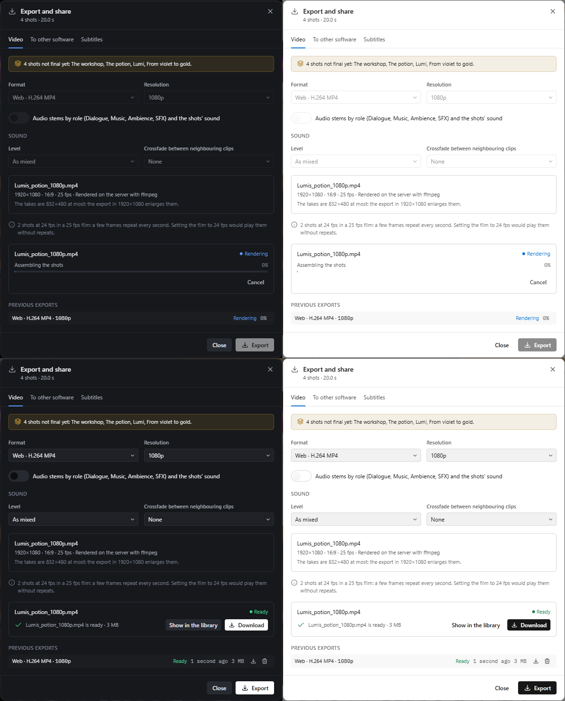

# Video Producer

Video Producer is a PotionUI plugin for making short films with AI video, in one page. A user writes a synopsis, splits it into shots, generates draft takes of each shot, keeps the best one and renders it in final quality, then cuts, matches the colors, mixes the sound and exports the film. Takes are real PotionUI generations, made by the engines and presets you give the users.

This page is for the administrator who installs and sets up the plugin. Users read **Video Producer: user guide**.









## Documentation

All the pages are in Admin › Documentation once the plugin is enabled; the user guide is also in the Documentation page that every signed-in user sees.

| Page | File | For |
|---|---|---|
| **Video Producer: administration** (this page) | `README.md` | The administrator: install, setup, settings. |
| **Video Producer: user guide** | `docs/user-guide.md` | Every user: how to make a film. |
| **Video Producer: complete reference** | `docs/user-reference.md` | Users who want every control and message explained. |
| **Video Producer: admin reference** | `docs/admin-reference.md` | The details behind this page: measures, full texts of the setup checks, models and presets, quotas, troubleshooting. |
| **Video Producer: technical reference** | `docs/technical-reference.md` | Developers: how the plugin works, its routes, tables, errors and tests. |

## Install and enable

1. In Admin › Plugins, click **Install from catalog**, paste the catalogue URL below, then click **Read catalog**:

   ```text
   https://raw.githubusercontent.com/M4-S4/potionui-plugins/main/plugins.json
   ```

2. Click **Install** next to **Video Producer**, then turn it on with **Enable plugin** if it is not running yet.
3. A **Video Producer** entry appears in the sidebar for every user. In Admin › Plugins, the plugin shows **Setup needed** until the setup steps of its **Overview** tab are done (see Setup steps below).

To install by hand instead, unzip the release archive into `content/plugins/local/`, then click **Scan for Plugins** in Admin › Plugins and enable the plugin.

## What you need

- **PotionUI** from the official repository, recent enough to offer **Install from catalog** and the plugin API for faces, with an admin account.
- **A video engine**: the native engine of this machine, a Studio server (a Remote Native worker), or a cloud provider with a video model (see Engines).
- **At least one video preset**, installed, assigned to the users who generate, and with its model files downloaded (see Choose the presets).
- **ffmpeg and ffprobe** on the PotionUI server, to export videos and to start a shot from the last image of the previous one (see ffmpeg).
- **A writable work folder** in the file storage directory of the server (see The work folder).
- **For final takes**, an upscaler assigned to the users: SeedVR2, or RTX Upscale from the NVIDIA RTX Upscale plugin (see Final takes and frame rate).
- **For the assistant**, optionally, a language model that can call tools, assigned to the users (see The assistant).
- **For a local engine**, an NVIDIA card of the Turing generation or newer, with driver 580 or newer. Video needs more than PotionUI's minimum: plan on the card and the system RAM of the table below.

## Choose the presets

What your users can make depends on your graphics card. Video Producer ships six presets set up for 8 GB and 12 GB cards, each with a recipe in Admin › Recipes that downloads its files, installs it and assigns it.

| Card | Presets to install and assign | System RAM | What the users get |
|---|---|---|---|
| 8 GB | **Wan 2.1 T2V 1.3B (8 GB)**, **Wan 2.2 TI2V 5B (8 GB)** | 32 GB | 480p clips of up to 5 seconds; the 5B can start from a first frame. |
| 12 GB | **MiniMax-H3 (12 GB)**, **MiniMax-H3-Fast (12 GB)** | 64 GB | Video with sound, up to 15 seconds, at 832×480 by default; **MiniMax-H3 (12 GB)** also follows references (Ref2VA). |
| 12 GB | **Wan 2.2 14B Lightning (12 GB)** with its companion **Wan 2.2 14B Lightning I2V (12 GB)** | 64 GB | Fast text to video, and image to video for the shots that start from an image. |

The other Video Director presets of PotionUI (Wan, LTX, MiniMax-H3 and its variants, OpenRouter Video, Gemini Video) work too once assigned. A preset that does not fit the card streams part of the model through the system RAM: the generation still runs, more slowly, and the production deck warns "Will stream through host RAM, slower".

### What to expect on a 12 GB card

Measured on an NVIDIA RTX 4070 Ti with 12 GB, with the native engine of PotionUI. Tell your users, and set **Max generations in flight per user** and the monthly GPU minutes with these times in mind.

| Engine | A 5-second take at 832×480 | System RAM | What does not fit |
|---|---|---|---|
| **MiniMax-H3 (12 GB)**, 20 steps | about 7.5 min | 64 GB; a draft finished with 32 GB, more slowly, and was killed at 29 GB | 1344×768 is offered but far heavier; no Upscale mode |
| **MiniMax-H3-Fast (12 GB)**, 8 steps | about 6 min | 64 GB; a draft was killed at 32 GB | No References mode |
| **Wan 2.2 14B Lightning (12 GB)**, 6 steps | about 3.5 min, once its 38 GB of files are read | 64 GB; about 35 GB used | 1280×720 runs out of memory |
| **Wan 2.2 14B Lightning I2V (12 GB)**, 4 steps | 2 min 15 s to 2 min 45 s | 64 GB | Sizes above 960×544 not measured |
| Core Wan 2.1 / 2.2 14B preset, 30 steps | about 26 min | about 42 GB used | |
| **Wan 2.1 T2V 1.3B (8 GB)** and **Wan 2.2 TI2V 5B (8 GB)**, card limited to 8 GB | about 5.5 and 4.5 min | 32 GB | The 5B at 720p: its decode needs far more than 8 GB |
| Core MiniMax-H3 presets, without the 12 GB profile | not measured | | Use the 12 GB presets on this card |
| LTX-2.3 22B distilled fp8 | | 62 GB | Runs out of GPU memory at 832×480 |
| SeedVR2 upscale of a 5-second draft to 1080p | about 2.5 hours | | |
| Export of a 29-second film at 1080p (ffmpeg, processor only) | 11 s | | |

The bench measures behind this table are in **Video Producer: technical reference**.

### MiniMax-H3: read before enabling

- **License.** The weights are published under the MiniMax H3 Community License, which is not an open-source license. Its territory excludes the European Union, the United Kingdom, the United States and the Republic of Korea, and the exclusion extends to what the model generates. Use there needs an individual authorization from MiniMax (https://platform.minimax.io/h3-license). A separate written authorization is required above US$20M of annual revenue, and a commercial product must display "MiniMax H3" prominently. PotionUI ships no weights: the license is between you and MiniMax. The Fast and VDN variants carry the same terms.
- **Files.** A MiniMax-H3 preset needs four files (DiT, text encoder, video VAE, audio VAE), and the base preset a fifth one for its Upscale mode. The Video mode needs the `fl2va` DiT file and the References mode the `ref2va` one: check the file names, since a wrong pick runs without an error and ignores the references.
- **Validation.** PotionUI's own documentation still lists the MiniMax-H3 family as not validated on real weights. The 12 GB presets of this plugin were measured on a 12 GB card.

### LTX-2.5 and its license

LTX-2.5 and its IC-LoRAs are published under the LTX-2.x Community License of Lightricks. Below US$10M of annual revenue every use is allowed, commercial included, within its terms; it asks users to say that a video is generated by AI where the law requires it. Read it before you install LTX-2.5. Two optional IC-LoRAs add features: Layout-To-Render for the guided final render, and Ingredients for the Ref2VA profile through a reference sheet (see the admin reference).

## Setup steps

The **Overview** tab of the plugin, in Admin › Plugins, lists six steps. Each one checks the instance as it is now, says what is missing and, when it can, offers a button to the right admin page.

| Step | Done when | What to do |
|---|---|---|
| **Enable a native backend or a cloud video model** | An engine that can run video presets is enabled: this machine with a GPU PotionUI can read, a running Studio server, or a cloud backend with a video model turned on. | Admin › Backends; for the cloud, install the provider plugin, add its backend with your API key and turn on a video model in its catalog. |
| **Install and assign at least one Video Director preset** | A video preset is installed and assigned to a user or a group. | Admin › Presets, then download its files in Admin › Downloads. |
| **Install SeedVR2 for final takes** | SeedVR2, or RTX Upscale, is installed and assigned. | Install the preset, assign it to the users who make finals, download its files. Assign Video Tools or RTX Upscale too, for the frame rate. |
| **Give Video Producer a writable work folder in the file storage directory** | The plugin can write in its work folder. | See The work folder. |
| **Install ffmpeg for video delivery** | ffmpeg and ffprobe are found by the server. | See ffmpeg. |
| **If a MiniMax-H3 preset is installed, install its five model files** | Every installed MiniMax-H3 preset has its files. | Admin › Downloads, Admin › Models. |

A preset installed but assigned to no one does not count: an administrator sees every installed preset, but other users only those assigned to them or to their groups. That is why something can work for you and not for a user.

### The work folder

Video Producer writes its work files in `<file storage directory>/video_producer/`: the exports, the frames taken from the shots, and the sound cut for the generation. This folder must be local and writable on the server, even when PotionUI keeps the media in object storage. If the setup step says "Video Producer cannot write in …", set a writable file storage directory in Admin › Settings, or mount one into the container.

### ffmpeg

Video Producer uses `ffmpeg` and `ffprobe`, as found on the `PATH` of the PotionUI process, to export the videos, to cut the sound sent with a shot, to start a shot from the last image of the previous one, and to read the frame rate of a take. Install both so that the PotionUI process finds them, then restart PotionUI; in Docker, check that the image contains them. Without ffmpeg, users cannot export a video (the export window says so) and those shots are blocked; the files for other software and the subtitles still work.

The export needs the `libx264` and `aac` encoders, `prores_ks` for the master file and `libx265` for the archive. The admin reference lists the filters it uses and the versions it was tested with.

## Settings

In Admin › Plugins › Video Producer › Settings:

| Setting | Default | What it does |
|---|---|---|
| **Draft resolution** | 832×480 | The size of draft takes: 832×480, 960×544 or 1280×720. A preset that does not offer it uses its closest size. Final takes use the largest size of the preset. |
| **Max generations in flight per user** | 2 | How many takes of one user run or wait in PotionUI at once, across all their projects (1 to 16). The others wait as **Queued** in Video Producer and start in order. |
| **Export cache per user (MB)** | 2048 | The size budget of each user's export folder. When it is full, the oldest finished exports are deleted to make room. |
| **Versions kept per project** | 50 | How many saved versions each project keeps (5 to 500). The oldest are deleted first. |

The language of the interface is not a setting: each user chooses it in the page. Every prompt is in English.

## Quotas

You can limit the GPU minutes each user spends on Video Producer each month:

1. Open Admin › Users › Plans and open a plan you created (the built-in plans take no new limit).
2. Click **Add limit** and pick **Video Producer GPU minutes per month**.
3. Enter the number of minutes, then assign the plan to groups or users.

A plan without this limit means unlimited minutes, and **Admins are exempt** applies as usual. Video Producer reserves the minutes of a take when it is created, adjusts them to the real duration when it ends, and gives them back when it fails or is cancelled. A running generation is never stopped by the quota. Until a preset has been measured, each second of video counts for 10 seconds of GPU. Cloud models use no GPU minutes: their spending falls under the PotionUI limit **Cloud spend per month**.

## Engines

- **This machine**: the native engine of the PotionUI server. Check that it is enabled in Admin › Backends, with a GPU device.
- **Studio server**: another machine, or rented compute, running a PotionUI Remote Native worker. Add a Remote Native backend in Admin › Backends. The model files must be on the worker too.
- **Cloud**: the presets **OpenRouter Video** and **Gemini Video**. Install the `openrouter-provider` or `google-gemini-provider` plugin, add its backend with your API key, then turn on a video model in its catalog. Each shot is one paid request to the provider; only administrators see the cost estimate.

ComfyUI backends are not offered: their presets do not run the Video Director documents that Video Producer builds. PotionUI chooses which backend runs a native take, by its own rules, and the take card shows it.

## Final takes and frame rate

- **SeedVR2** upscales a chosen draft to 720p, 1080p, 1440p or 4K and restores detail. It is slow. A take of the base MiniMax-H3 preset uses that preset's own Upscale mode instead.
- **RTX Upscale**, from the NVIDIA RTX Upscale plugin, upscales a take in a few seconds without adding detail. It needs the `nvidia-vfx` package on the server (on the worker, for a Studio server).
- **Guided render**, optional, renders a shot again with LTX-2.5 following its draft. It needs LTX-2.5 and its Layout-To-Render IC-LoRA, assigned to the users.
- **Interpolators** bring the takes slower than the film to its frame rate, so the export does not repeat frames: **Video Tools** (RIFE 4.25) or **RTX Upscale** (NVIDIA Frame Generation, `nvidia-vfx` 0.2 or later). Assign one to the users.

Upscalers, interpolators and the guided render run on a native backend. On an instance with cloud backends only, they are not available.

## The assistant

The assistant is a mode of the PotionUI chat, **Video Producer assistant**, whose tools drive the page. To offer it:

1. In Admin › LLM / Assistant, click **Add configuration** and add a model that can call tools.
2. Assign the configuration to the users or groups who use Video Producer.

When the model shares the graphics card with the video, use a local llama.cpp `llama-server`, added as an OpenAI configuration: it reserves its memory at load time and can unload on demand. Ollama works once its **Context Size** is 16384 and its thinking mode is off. An online provider such as OpenAI works too, but the project summary sent with each message then leaves your server. The model built into PotionUI is not recommended on a 12 GB card. The admin reference gives the tested commands and settings.

## Troubleshooting

- **"No engine" in the production deck.** The first setup step is not done, the backend is off, no video preset is assigned to the user, or the cloud backend has no video model turned on.
- **"Models to install for this preset: …".** Download the files of that preset in Admin › Downloads or Admin › Models.
- **A take failed with `cuda_oom`.** The card ran out of memory. Lower the **Draft resolution**, use shorter shots, close other GPU programs, or switch to a lighter preset. If every take then fails within seconds, restart the backend (Admin › Backends) or PotionUI.
- **A take failed with `missing_model_file`.** A model file the preset needs is missing. Download it again; for a Studio server, it must be on the worker.
- **An upscale or a conform works for you and not for a user.** SeedVR2, RTX Upscale or Video Tools is installed but assigned to no one. Assign it.
- **References are ignored with MiniMax-H3.** The `fl2va` DiT file was picked for the References mode.
- **"ffmpeg is missing on the server".** Install ffmpeg and ffprobe on the `PATH` of the PotionUI process, then restart PotionUI.
- **"The export folder is full".** Raise **Export cache per user (MB)**, or ask the user to delete older exports.
- **An export stays Queued.** The server runs one export at a time, for everybody.
- **"Chat is currently unavailable".** No language model is assigned to the user.

The admin reference has the complete list, with the error codes.

## License

GPL-3.0, like PotionUI. The licenses of the models you use with it are separate: read those of MiniMax-H3 and LTX-2.5 above. The three images of the starter project ship with the plugin under its license; the admin reference says how they were made.
